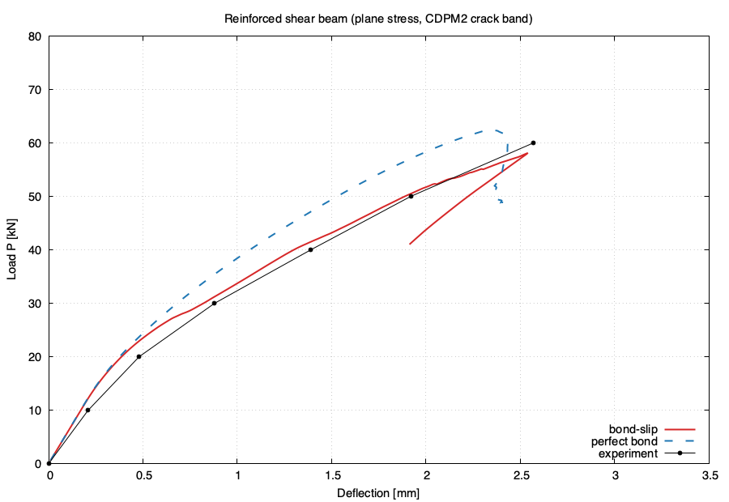

# CDPM2: reinforced concrete shear beam with bond-slip (plane stress, crack band)

Leonhardt and Walther beam no. 5, the same beam, mesh and concrete model as
[`cdpm2-reinforced-2d`](../cdpm2-reinforced-2d/), but with **bond-slip**
between the reinforcement and the concrete instead of perfect bond. The
concrete is modelled with the crack-band (local) version of the Concrete
Damage Plasticity Model 2 (`con2dpm`) in **plane stress**. The longitudinal
reinforcement is modelled with truss elements. Each bar node is connected to
a hanging node at the same position, constrained to the concrete element it
lies in, by a `bondlink2dtruss` element with the `linkslip` bond-slip law.
Half the beam is analysed (symmetry at midspan).

The mesh has an element size of 20 mm in the refined region (1262 nodes, of
which 64 hanging; 2247 elements, of which 63 trusses and 64 bond links).

Geometry, concrete parameters and experiment follow Xenos and Grassl (2016)
(see [Related work](#related-work)).

## Referenced by

- Blog post: https://petergrassl.com/blog/cdpm2-bondslip-2d/

## Reproduce

With the public Docker image (no compilation needed):

```bash
git clone https://github.com/githubgrasp/oofem-examples.git
cd oofem-examples/cdpm2-bondslip-2d
docker run --rm -v "$PWD":/work ghcr.io/githubgrasp/oofem-public:latest bash run.sh
```

The analysis takes about 8 minutes. The committed `ld.dat` already
holds the result, so to rebuild **only the figure**:

```bash
docker run --rm -v "$PWD":/work ghcr.io/githubgrasp/oofem-public:latest bash -c 'SKIP_RUN=1 bash run.sh'
```

## What you get

| file             | content                                                     |
|------------------|-------------------------------------------------------------|
| `mesh.in`        | T3D geometry (incl. reinforcement curve)                    |
| `oofem.t3d.ctrl` | t3d2oofem control file (materials, BCs, extractor block)    |
| `oofem.in`       | standalone OOFEM input (full mesh, duplicated nodes and bond links embedded) |
| `experiment.dat` | experiment: `load P [kN]  midspan deflection [m]`           |
| `ld-perfect.dat` | perfect-bond result from `cdpm2-reinforced-2d`, same columns as `ld.dat` |
| `ld.dat`         | `loadlevel[N]  u_y(node 4)  u_y(node 15)  u_y(node 505)  u_y(node 618)` in metres |
| `ld.pdf/png`     | load vs midspan deflection: bond-slip, perfect bond, experiment |
| `std.out`        | OOFEM stdout                                                |
| `oofem.out`      | OOFEM solver output (+ `.vtu` every 5th step)               |

Load and deflection are derived from `ld.dat` as:

- `Load P [kN]       = -col1 / 1000`  (load on the half beam = one load point)
- `Deflection [mm]   = -col2 * 1000`  (bottom of the beam at midspan, node 4)

Column 3 is the vertical displacement of the load point (node 15, centre of
the loading plate). Columns 4 and 5 are the vertical displacements of the
control nodes 505 and 618; their difference (col5 - col4) is the quantity
controlled after the peak (see [Load control](#load-control)).

`bash clean.sh` removes the generated outputs. It keeps the committed inputs,
`ld.dat`, `ld-perfect.dat`, `experiment.dat` and the figure.

## Geometry and material

Geometry, supports, loading plates and concrete (`con2dpm`, mat 1) are those
of [`cdpm2-reinforced-2d`](../cdpm2-reinforced-2d/README.md#geometry-and-material).
The reinforcement and the bond:

| part                  | model      | parameters                                                     |
|-----------------------|------------|----------------------------------------------------------------|
| reinforcement (mat 3) | `isole`, `truss2d` | `E = 200 GPa`, 2 bars of 26 mm, `A_s = 1061.9 mm^2`, at 50 mm above the bottom face |
| bond (mat 4, cs 3)    | `linkslip` type 2, `bondlink2dtruss`, `interfacecs` | `t0 = 11.32 MPa`, `s1 = 1 mm`, `s2 = 2 mm`, `s3 = 8.5 mm`, `tf = 4.53 MPa`, `alpha = 0.4`, `kn = 4.53e10 Pa/m`, `kl = 4.53e13 Pa/m` |

The bond-slip law is the Model Code 2010 law for pull-out failure in good
bond conditions, with `fck = fcm - 8 MPa = 20.5 MPa`:

- `t0 = 2.5 sqrt(fck) = 11.32 MPa`, `tf = 0.4 t0 = 4.53 MPa`, `alpha = 0.4`,
  `s1 = 1 mm`, `s2 = 2 mm`.
- `s3` is the clear rib spacing; 8.5 mm (about d/3) is an assumed value.
- `kn = 4 t0 / s1` is the initial slip stiffness (it must exceed `t0 / s1`).
- `kl = 1000 kn` is the lateral stiffness across the bar, a penalty value
  that keeps the bar on the concrete transversally.

The two bars are lumped into one truss, so the bond perimeter is that of two
bars: the links use `diameter 0.052` (2 x 26 mm), since the bond area is
`pi * diameter * length`.

The beam has no stirrups and the cover (37 mm) is less than 5 bar diameters,
so Model Code 2010 would classify the bond failure as splitting rather than
pull-out. The pull-out law is used here because the 2D concrete model
already describes the splitting cracks along the bar.

### Reinforcement and bond links in the mesh

In `mesh.in` the bar is a free curve (`curve 12 vertex 9 10 output yes`), not
attached to the outline and not fixed to any patch, so T3D meshes it
independently of the concrete. `t3d2oofem` writes the bar as `truss2d`
elements on ordinary nodes (`oofemTemp.in`). The `duplicate` tool
(`tools/duplicate` in the [OOFEM fork](https://github.com/githubgrasp/oofem))
then

- adds, for every bar node, a hanging node at the same position
  (`doftype 2 2 2`, no `masterElement`: OOFEM finds the host concrete element
  and interpolates the node's displacements from it), and
- joins the bar node and the hanging node with a `bondlink2dtruss`, whose
  bond length is the tributary length of the bar node (half an element at the
  bar ends).

`bondlink2dtruss` resolves the relative displacement of the two nodes into
the slip along the bar (`linkslip` bond-slip law) and the lateral component
across it (stiffness `kl`). The bar end at the symmetry plane (vertex 10) has
its own `u_x = 0`, because the bar no longer follows the concrete in x.

### Load control

As in `cdpm2-reinforced-2d`, indirect displacement control (arc length with
`hpcmode 2`) in two metasteps:

1. Up to the peak (244 steps): the vertical displacement of the load point
   (node 15) increases by 10 &micro;m per step.
2. Through the snap-back (100 steps): the controlled quantity is the
   vertical relative displacement `u_y(618) - u_y(505)` across the element
   row just above the bars, at x = 0.74-0.75 m
   (`hpc 4 618 2 505 2 hpcw 2 1 -1`), increased by 0.1 &micro;m per step.

The control nodes were chosen from the failure pattern. A run with
load-point control alone passes the peak, but the load then drops in a
single step, from 58 to about 45 kN. In that step the concrete above the bars
cracks along them between x = 0.67 and 0.77 m (damage goes to 1 in one
step). Nodes 505 and 618 lie on either side of that crack. Several other
choices were tried and also jumped in one step: a weighted sum of load-point
displacement and the opening across the bars at x = 0.75 m (nodes 18 and
19), and horizontal relative displacements in the web.

Nodes 505 and 618 are ordinary mesh nodes, not T3D vertices: regenerating
the mesh with the same `mesh.in` and `-d 0.02` gives the same node numbers,
but a different mesh needs new control nodes. Fixing two vertices at and
above the bar instead changes the mesh, and with those the analysis failed
(elements deleted after the plastic return of CDPM2 did not converge). The
control that works depends on the failure pattern of the particular mesh,
so the practical procedure is to run with load-point control first, look
at where the crack localises at the jump, and then choose the control nodes
across it.

## Results



- **Pre-peak:** with bond-slip the response follows the experiment closely
  (30, 40 and 50 kN). With perfect bond the beam is too stiff once the
  flexural cracks form, because the bars cannot slip and the cracks stay
  narrower.
- **Peak:** 58.1 kN at a midspan deflection of 2.54 mm (step 244). The last
  recorded experimental point is 60 kN at 2.57 mm. Perfect bond gives
  62.3 kN at 2.36 mm.
- **Snap-back:** after the peak, load and midspan deflection decrease
  together. The control of `u_y(618) - u_y(505)` follows this in 100 steps
  of 200 to 400 iterations each, down to 41.0 kN at 1.91 mm (step 344), where
  the analysis stops while the deflection is still decreasing. All 344 steps
  converge.
- **Failure pattern:** the diagonal crack runs from the loading plate
  towards the bars at about x = 0.75-0.85 m. During the snap-back the strain
  increments concentrate along this crack and its continuation through the
  cover to the bottom face. The controlled opening above the bars grows only
  by about 10 &micro;m over the 100 steps.

## Related work

> Xenos D, Grassl P. *Modelling the failure of reinforced concrete with
> nonlocal and crack band approaches using the damage-plasticity model CDPM2.*
> Finite Elements in Analysis and Design 117-118 (2016) 11-20.
> [doi:10.1016/j.finel.2016.04.002](https://doi.org/10.1016/j.finel.2016.04.002)

> Grassl P, Johansson M, Leppänen J. *On the numerical modelling of bond for
> the failure analysis of reinforced concrete.* Engineering Fracture
> Mechanics 189 (2018) 13-26.
> [doi:10.1016/j.engfracmech.2017.10.008](https://doi.org/10.1016/j.engfracmech.2017.10.008)

Experiment: F. Leonhardt, R. Walther, *Schubversuche an einfeldrigen
Stahlbetonbalken mit und ohne Schubbewehrung zur Ermittlung der
Schubtragfähigkeit und der oberen Schubspannungsgrenze*, Deutscher Ausschuss
für Stahlbeton (DAfStb), 1962.

Bond-slip law: fib Model Code for Concrete Structures 2010, Section 6.1.

## Mesh regeneration (students, private image)

`oofem.in` is committed standalone, so the public image needs no mesh tool.
To regenerate it from the T3D source:

```bash
t3d -d 0.02 -p 8 -i mesh.in -o mesh.out
t3d2oofem oofem.t3d.ctrl mesh.out oofemTemp.in
duplicate oofemTemp.in oofem.in --diameter 0.052 --bond 3 4
```

## Citing

This example is part of the oofem-examples repository, archived on Zenodo.
To cite it, use the DOI
[10.5281/zenodo.23473097](https://doi.org/10.5281/zenodo.23473097), which
always resolves to the latest release. See the
[top-level README](../README.md#citing) for version-specific DOIs.
