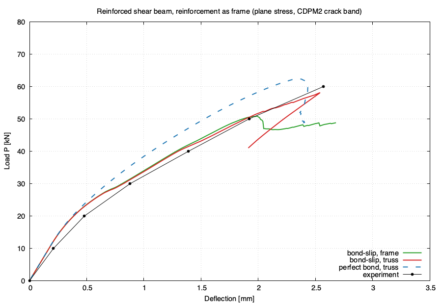

# CDPM2: reinforced concrete shear beam, bond-slip with the reinforcement as frame (plane stress, crack band)

Leonhardt and Walther beam no. 5, the same beam, mesh, concrete model and
bond-slip law as [`cdpm2-bondslip-2d`](../cdpm2-bondslip-2d/), but with the
reinforcement modelled as **frame elements** (`lattice2d` with a circular
section: axial, shear and bending stiffness) instead of trusses. The bar can
therefore carry dowel forces across the cracks. The concrete is modelled
with the crack-band (local) version of the Concrete Damage Plasticity Model
2 (`con2dpm`) in **plane stress**. Each bar node is connected to a hanging
node at the same position, constrained to the concrete element it lies in,
by an `intelpoint` interface element with the `linkslip` bond-slip law, as in
`cdpm2-bondslip-2d`. Half the beam is analysed (symmetry at midspan).

The mesh has an element size of 20 mm in the refined region (1262 nodes, of
which 64 hanging; 2247 elements, of which 63 frame elements and 64 bond
links).

Geometry, concrete parameters and experiment follow Xenos and Grassl (2016)
(see [Related work](#related-work)).

## Referenced by

- Blog post: https://petergrassl.com/blog/cdpm2-reinforced-beam-2d/

## Reproduce

With the public Docker image (no compilation needed):

```bash
git clone https://github.com/githubgrasp/oofem-examples.git
cd oofem-examples/cdpm2-reinforced-beam-2d
docker run --rm -v "$PWD":/work ghcr.io/githubgrasp/oofem-public:latest bash run.sh
```

The analysis takes about 5 minutes. The committed `ld.dat` already
holds the result, so to rebuild **only the figure**:

```bash
docker run --rm -v "$PWD":/work ghcr.io/githubgrasp/oofem-public:latest bash -c 'SKIP_RUN=1 bash run.sh'
```

The example needs an OOFEM build that includes the circular section and
the `gpCoords` default of `lattice2d` (OOFEM fork, October 2026).

## What you get

| file             | content                                                     |
|------------------|-------------------------------------------------------------|
| `mesh.in`        | T3D geometry (incl. reinforcement curve), same as `cdpm2-bondslip-2d` |
| `oofem.t3d.ctrl` | t3d2oofem control file (materials, BCs, extractor block)    |
| `oofem.in`       | standalone OOFEM input (full mesh, duplicated nodes and bond links embedded) |
| `experiment.dat` | experiment: `load P [kN]  midspan deflection [m]`           |
| `ld-truss.dat`   | bond-slip result with truss reinforcement, from `cdpm2-bondslip-2d` |
| `ld-perfect.dat` | perfect-bond result from `cdpm2-reinforced-2d`              |
| `ld.dat`         | `loadlevel[N]  u_y(node 4)  u_y(node 15)` in metres         |
| `ld.pdf/png`     | load vs midspan deflection: frame, truss, perfect bond, experiment |
| `std.out`        | OOFEM stdout                                                |
| `oofem.out`      | OOFEM solver output (+ `.vtu` every 5th step)               |

Load and deflection are derived from `ld.dat` as:

- `Load P [kN]       = -col1 / 1000`  (load on the half beam = one load point)
- `Deflection [mm]   = -col2 * 1000`  (bottom of the beam at midspan, node 4)

Column 3 is the vertical displacement of the load point (node 15, centre of
the loading plate). The first two columns of `ld-truss.dat` and
`ld-perfect.dat` have the same meaning.

`bash clean.sh` removes the generated outputs. It keeps the committed inputs,
`ld.dat`, `ld-truss.dat`, `ld-perfect.dat`, `experiment.dat` and the figure.

## Geometry and material

Geometry, supports, loading plates and concrete (`con2dpm`, mat 1) are those
of [`cdpm2-reinforced-2d`](../cdpm2-reinforced-2d/README.md#geometry-and-material).
The reinforcement and the bond:

| part                  | model      | parameters                                                     |
|-----------------------|------------|----------------------------------------------------------------|
| reinforcement (mat 3, cs 2) | `latticeframeelastic`, `lattice2d`, `latticecs` (`shape 1`) | `E = 200 GPa`, `nu = 0.3`, `radius 0.018385`, `area 1.06186e-3` (`A_s` of 2 bars of 26 mm), `iz 4.4863e-8`, at 50 mm above the bottom face |
| bond (mat 4, cs 3)    | `linkslip` type 2, `intelpoint`, `interfacecs` | `t0 = 11.32 MPa`, `s1 = 1 mm`, `s2 = 2 mm`, `s3 = 8.5 mm`, `tf = 4.53 MPa`, `alpha = 0.4`, `kn = 4.53e10 Pa/m`, `kl = 4.53e13 Pa/m` |

The reinforcement section:

- The two bars are lumped into one frame element. The circular section has
  the area of the two bars (`radius` and `area`).
- `iz` is the moment of inertia of two separate 26 mm bars,
  `2 pi 0.013^4 / 4`. One circle with the same area would have twice that.
- The shear area is the default `0.9 A`.
- `lattice2d` is used without `gpCoords`, so its integration point is the
  element midpoint (no eccentricity).

The bond (material, link element and parameters) is the same as in
[`cdpm2-bondslip-2d`](../cdpm2-bondslip-2d/README.md#geometry-and-material):
the Model Code 2010 law for pull-out failure in good bond conditions for the
slip along the bar, and the lateral stiffness `kl` across it. The links use
`diameter 0.052` (2 x 26 mm), since the bond area is
`pi * diameter * length`. The link uses only the translations of the two
nodes, so the rotation of the bar node is not tied to the concrete; it is
carried by the frame elements.

### Reinforcement and bond links in the mesh

In `mesh.in` the bar is a free curve (`curve 12 vertex 9 10 output yes`), not
attached to the outline and not fixed to any patch, so T3D meshes it
independently of the concrete. `t3d2oofem` writes the bar as `lattice2d`
elements on ordinary nodes (`oofemTemp.in`). The `duplicate` tool
(`tools/duplicate` in the [OOFEM fork](https://github.com/githubgrasp/oofem))
then, as for the trusses in `cdpm2-bondslip-2d`,

- adds, for every bar node, a hanging node at the same position
  (`doftype 2 2 2`, no `masterElement`: OOFEM finds the host concrete
  element and interpolates the node's displacements from it), and
- joins the hanging node and the bar node with an `intelpoint` (nodes in
  that order), whose `area` is the bar perimeter (pi x 52 mm for the two
  bars) times the length of bar assigned to the bar node (half of each
  adjacent element), and whose `normal` is the bar direction.

The bar end at the symmetry plane (vertex 10) has `u_x = 0` and zero
rotation (`dofidmask 3 1 2 6 bc 3 1 0 1`).

### Load control

Indirect displacement control (arc length with `hpcmode 2`) in one
metastep: the vertical displacement of the load point (node 15) increases by
10 &micro;m per step, for 195 steps. Step 196, during the drop after the
peak, does not converge with this control, so the analysis ends at step 195.

## Results



- **Pre-peak:** the frame and the truss model follow the same curve up to
  about 1.9 mm (50 kN), close to the experimental points at 30, 40 and
  50 kN.
- **Peak:** 50.8 kN at a midspan deflection of 1.99 mm (step 191). With
  truss reinforcement the peak is 58.1 kN at 2.54 mm. The last recorded
  experimental point is 60 kN at 2.57 mm.
- **Post-peak:** the load decreases to 49.7 kN at 2.03 mm (step 195).
- **Failure pattern:** at the peak (steps 185 to 195), damage grows at the
  tip of the diagonal crack (x = 0.89-0.93 m, y = 0.20-0.23 m) and in a
  crack along the top of the bar (y = 0.058-0.064 m, x = 0.65-0.68 m).

## Related work

> Xenos D, Grassl P. *Modelling the failure of reinforced concrete with
> nonlocal and crack band approaches using the damage-plasticity model CDPM2.*
> Finite Elements in Analysis and Design 117-118 (2016) 11-20.
> [doi:10.1016/j.finel.2016.04.002](https://doi.org/10.1016/j.finel.2016.04.002)

> Grassl P, Johansson M, Leppänen J. *On the numerical modelling of bond for
> the failure analysis of reinforced concrete.* Engineering Fracture
> Mechanics 189 (2018) 13-26.
> [doi:10.1016/j.engfracmech.2017.10.008](https://doi.org/10.1016/j.engfracmech.2017.10.008)

> Sciegaj A, Grassl P, Larsson F, Runesson K, Lundgren K. *Upscaling of
> three-dimensional reinforced concrete representative volume elements to
> effective beam and plate models.* International Journal of Solids and
> Structures 202 (2020) 835-853.
> [doi:10.1016/j.ijsolstr.2020.07.006](https://doi.org/10.1016/j.ijsolstr.2020.07.006)
> (origin of the node-to-node bond links between reinforcement and concrete
> used here)

Experiment: F. Leonhardt, R. Walther, *Schubversuche an einfeldrigen
Stahlbetonbalken mit und ohne Schubbewehrung zur Ermittlung der
Schubtragfähigkeit und der oberen Schubspannungsgrenze*, Deutscher Ausschuss
für Stahlbeton (DAfStb), 1962.

Bond-slip law: fib Model Code for Concrete Structures 2010, Section 6.1.

## Mesh regeneration (students, private image)

`oofem.in` is committed standalone, so the public image needs no mesh tool.
To regenerate it from the T3D source:

```bash
t3d -d 0.02 -p 8 -i mesh.in -o mesh.out
t3d2oofem oofem.t3d.ctrl mesh.out oofemTemp.in
duplicate oofemTemp.in oofem.in --diameter 0.052 --bond 3 4
```

## Citing

This example is part of the oofem-examples repository, archived on Zenodo.
To cite it, use the DOI
[10.5281/zenodo.23473097](https://doi.org/10.5281/zenodo.23473097), which
always resolves to the latest release. See the
[top-level README](../README.md#citing) for version-specific DOIs.
