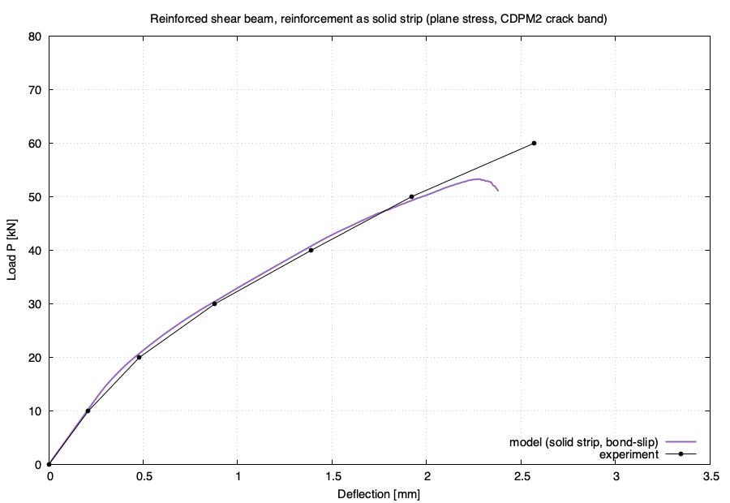

# CDPM2: reinforced concrete shear beam, bond-slip with the reinforcement as a solid strip (plane stress, crack band)

Leonhardt and Walther beam no. 5, with the same concrete model and bond-slip
law as [`cdpm2-bondslip-2d`](../cdpm2-bondslip-2d/), but with the
reinforcement modelled as a **solid steel strip** of plane stress elements
instead of truss or frame elements. The strip is joined to the concrete
along its top and bottom by **interface elements** (`intelline1`) with the
CEB/Model Code bond-slip law (`bondceb`). The concrete is modelled with the
crack-band (local) version of the Concrete Damage Plasticity Model 2
(`con2dpm`) in **plane stress**. Half the beam is analysed (symmetry at
midspan).

The mesh has an element size of 20 mm, refined to 7.5 mm along the strip
(3599 nodes; 6308 triangles and 340 interface elements).

Geometry, concrete parameters and experiment follow Xenos and Grassl (2016)
(see [Related work](#related-work)).

## Referenced by

- none yet (parked in wip)

## Reproduce

With the public Docker image (no compilation needed):

```bash
git clone https://github.com/githubgrasp/oofem-examples.git
cd oofem-examples/cdpm2-reinforced-solid-2d
docker run --rm -v "$PWD":/work ghcr.io/githubgrasp/oofem-public:latest bash run.sh
```

The analysis takes about 35 minutes. The committed `ld.dat` already holds
the result, so to rebuild **only the figure**:

```bash
docker run --rm -v "$PWD":/work ghcr.io/githubgrasp/oofem-public:latest bash -c 'SKIP_RUN=1 bash run.sh'
```

## What you get

| file             | content                                                     |
|------------------|-------------------------------------------------------------|
| `mesh.in`        | T3D geometry (beam, steel strip, interfaces)                |
| `oofem.t3d.ctrl` | t3d2oofem control file (materials, BCs, extractor block)    |
| `oofem.in`       | standalone OOFEM input (full mesh with interface elements)  |
| `experiment.dat` | experiment: `load P [kN]  midspan deflection [m]`           |
| `ld.dat`         | `loadlevel[N]  u_y(node 4)  u_y(node 15)` in metres         |
| `ld.pdf/png`     | load vs midspan deflection: model and experiment            |
| `std.out`        | OOFEM stdout                                                |
| `oofem.out`      | OOFEM solver output (+ `.vtu` every 5th step)               |

Load and deflection are derived from `ld.dat` as:

- `Load P [kN]       = -col1 / 1000`  (load on the half beam = one load point)
- `Deflection [mm]   = -col2 * 1000`  (bottom of the beam at midspan, node 4)

Column 3 is the vertical displacement of the load point (node 15, centre of
the loading plate).

`bash clean.sh` removes the generated outputs. It keeps the committed inputs,
`ld.dat`, `experiment.dat` and the figure.

## Geometry and material

Geometry, supports, loading plates and concrete (`con2dpm`, mat 1) are those
of [`cdpm2-reinforced-2d`](../cdpm2-reinforced-2d/README.md#geometry-and-material).
Unlike there, the mesh has no coarser end region. The reinforcement and the
bond:

| part                  | model      | parameters                                                     |
|-----------------------|------------|----------------------------------------------------------------|
| reinforcement (mat 3, cs 2) | `isole`, `trplanestress2d`, `SimpleCS` | `E = 200 GPa`, `nu = 0.3`, strip height 22.517 mm, `thick 0.047159`, centred at 50 mm above the bottom face |
| bond (mat 4, cs 3)    | `bondceb`, `intelline1`, `InterfaceCS` | `taumax = 11.32 MPa`, `s1 = 1 mm`, `s2 = 2 mm`, `s3 = 8.5 mm`, `tauf = 4.53 MPa`, `al = 0.4`, `ks = 4.53e10 Pa/m`, `kn = 4.53e13 Pa/m`, `thickness 0.081681` |

The steel strip:

- The two 26 mm bars are lumped into one strip. Its height and thickness
  are chosen so that both the area and the moment of inertia equal those
  of the two bars: `A = 1.06186e-3 m^2`, `I = 2 pi 0.013^4 / 4 =
  4.4863e-8 m^4`, giving `h = sqrt(12 I / A) = 22.517 mm` and
  `b = A / h = 47.159 mm`.
- Over the height of the strip there is only steel. The concrete below the
  strip (cover) and above it are connected to the steel, and through it to
  each other, only by the interface elements. The concrete beside and
  between the bars, which in the real beam connects the cover to the web,
  cannot be represented in this 2D model.

The bond:

- The bond-slip law is the Model Code 2010 law for pull-out failure in good
  bond conditions, with the same parameters as in
  [`cdpm2-bondslip-2d`](../cdpm2-bondslip-2d/README.md#geometry-and-material),
  applied to the slip along the interface (`ks` is the initial slip
  stiffness). In the normal direction the interface is elastic with the
  penalty stiffness `kn`.
- Each of the two interfaces (top and bottom of the strip) carries half the
  perimeter of the two bars: `thickness = pi * 0.052 / 2 = 0.081681 m`.

### Strip and interfaces in the mesh

In `mesh.in` the steel strip (patch 3) has its own vertices and curves. Its
top and bottom curves coincide with the top curve of the concrete below
(patch 1) and the bottom curve of the concrete above (patch 2). T3D joins each pair of coinciding curves by one
layer of 4-node interface elements:

```
interface 1 type curve 5 13
interface 2 type curve 7 15
```

The two curves of an interface must have the same orientation, otherwise
T3D pairs the wrong nodes. `t3d2oofem` writes the interface elements as
`intelline1` (`quadtype intelline1` on `interface 1 2` in
`oofem.t3d.ctrl`) with their nodes in the order `intelline1` expects. No
further tool is needed.

The symmetry plane x = 1.275 m has `u_x = 0` for the concrete and for the
steel strip.

### Load control

Indirect displacement control (arc length with `hpcmode 2`) in one
metastep: the vertical displacement of the load point (node 15) increases by
10 &micro;m per step, for 230 steps (the last converged step after the
peak).

## Results



- **Pre-peak:** the model follows the experiment closely. At the
  experimental load levels of 10 to 50 kN the midspan deflection differs by
  at most 5 % (0.86 mm against 0.88 mm at 30 kN, 1.98 mm against 1.92 mm
  at 50 kN).
- **Peak:** 53.3 kN at a midspan deflection of 2.28 mm (step 220). The last
  recorded experimental point is 60 kN at 2.57 mm.
- **Post-peak:** the load decreases slowly to 51.0 kN at 2.38 mm
  (step 230), where the analysis stops.
- **Failure pattern:** at the peak (steps 210 to 220), damage grows in the
  concrete just above the steel strip (y = 0.063-0.066 m, top edge of the
  strip at 0.061 m) at x = 0.66-0.70 m. After the peak this crack along the
  top of the strip spreads towards the support (x = 0.61-0.64 m).

## Related work

> Xenos D, Grassl P. *Modelling the failure of reinforced concrete with
> nonlocal and crack band approaches using the damage-plasticity model CDPM2.*
> Finite Elements in Analysis and Design 117-118 (2016) 11-20.
> [doi:10.1016/j.finel.2016.04.002](https://doi.org/10.1016/j.finel.2016.04.002)

> Grassl P, Johansson M, Leppänen J. *On the numerical modelling of bond for
> the failure analysis of reinforced concrete.* Engineering Fracture
> Mechanics 189 (2018) 13-26.
> [doi:10.1016/j.engfracmech.2017.10.008](https://doi.org/10.1016/j.engfracmech.2017.10.008)

Experiment: F. Leonhardt, R. Walther, *Schubversuche an einfeldrigen
Stahlbetonbalken mit und ohne Schubbewehrung zur Ermittlung der
Schubtragfähigkeit und der oberen Schubspannungsgrenze*, Deutscher Ausschuss
für Stahlbeton (DAfStb), 1962.

Bond-slip law: fib Model Code for Concrete Structures 2010, Section 6.1.

## Mesh regeneration (students, private image)

`oofem.in` is committed standalone, so the public image needs no mesh tool.
To regenerate it from the T3D source:

```bash
t3d -d 0.02 -p 8 -i mesh.in -o mesh.out
t3d2oofem oofem.t3d.ctrl mesh.out oofem.in
```

## Citing

This example is part of the oofem-examples repository, archived on Zenodo.
To cite it, use the DOI
[10.5281/zenodo.23473097](https://doi.org/10.5281/zenodo.23473097), which
always resolves to the latest release. See the
[top-level README](../README.md#citing) for version-specific DOIs.
